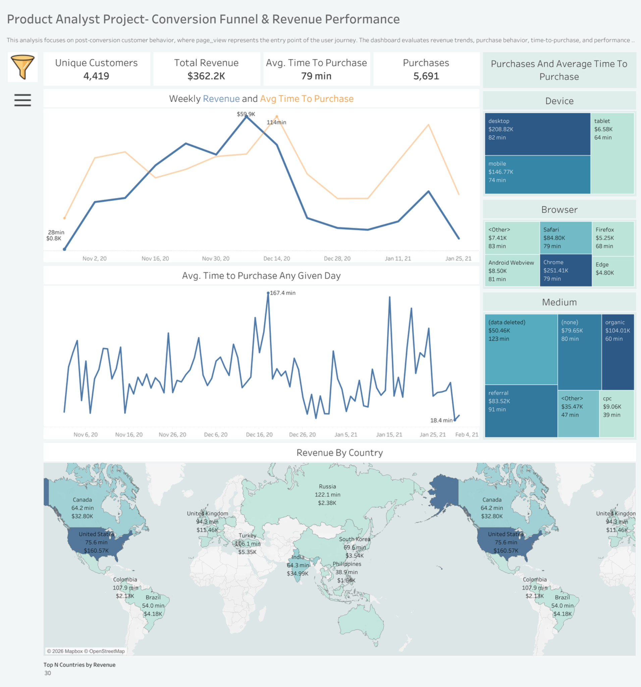

# Product Manager Portfolio | Jamie Christian II

**Product discovery · Conversion & retention · Experiment design · Prioritization · Data-informed decisions**

> **Review in 5 minutes:** Choose a project in the table below, open its case study, then inspect its PRD, prototype or wireframes, metrics, and release decision artifacts. This repository contains **six product portfolio case studies**. They are learning and simulation projects, not claims of shipped client products.

## Portfolio at a glance

I approach product management through the complete decision cycle:

**Customer / business problem → Evidence → Hypothesis → Opportunity sizing → Prioritization → Requirements → Design → Experiment → Launch criteria → Learning**

Projects emphasize how a PM works with engineering, design, analytics, and stakeholders to make explicit trade-offs, not just how dashboards look.

### Six case studies — start here

| Project | Core product question | Representative evidence |
| --- | --- | --- |
| [01 · Ecommerce conversion optimization](Ecommerce_Conversion_Optimization/README.md) | How might product discovery reduce purchasing friction? | [PM case study](Ecommerce_Conversion_Optimization/Product_Validation_and_Launch/06_PM_Case_Study_and_Interview_Story.md) · [PRD](Ecommerce_Conversion_Optimization/Proficiencies/Word_PRD.pdf) · [Wireframe](Ecommerce_Conversion_Optimization/Wireframes_Mockups/Wireframes.png) |
| [02 · Feature adoption intelligence](Feature_Adoption_Intelligence/README.md) | Which onboarding improvements could drive meaningful adoption? | [PM case study](Feature_Adoption_Intelligence/Product_Validation_and_Launch/06_PM_Case_Study_and_Interview_Story.md) · [PRD](Feature_Adoption_Intelligence/Proficiencies/Word_PRD.pdf) · [Wireframe](Feature_Adoption_Intelligence/Wireframes_Mockups/Wireframes.png) |
| [03 · Marketplace seller performance](Marketplace_Seller_Performance/README.md) | Which seller insights and workflows would improve marketplace health? | [PM case study](Marketplace_Seller_Performance/Product_Validation_and_Launch/06_PM_Case_Study_and_Interview_Story.md) · [Power BI source](Marketplace_Seller_Performance/Dashboard/Amazon_Marketplace_Analytics_Dashboard.pbix) |
| [04 · Revenue & pricing strategy](Revenue_Pricing_Strategy/README.md) | How should pricing decisions balance revenue, retention, and fairness? | [PM case study](Revenue_Pricing_Strategy/Revenue_Pricing_Strategy/Product_Validation_and_Launch/06_PM_Case_Study_and_Interview_Story.md) · [PRD](Revenue_Pricing_Strategy/Proficiencies/Word_PRD.pdf) |
| [05 · SaaS retention & churn](SaaS_Retention_Churn_Reduction/README.md) | Which churn drivers are actionable, and how can an intervention be evaluated? | [PM case study](SaaS_Retention_Churn_Reduction/Product_Validation_and_Launch/06_PM_Case_Study_and_Interview_Story.md) · [Wireframe](SaaS_Retention_Churn_Reduction/Wireframes_Mockups/Wireframes.png) |
| [06 · First-purchase user journey](User_Journey_First_Purchase/README.md) | Where do first-time buyers drop off, and what should be tested first? | [PM case study](User_Journey_First_Purchase/Product_Validation_and_Launch/06_PM_Case_Study_and_Interview_Story.md) · [PRD](User_Journey_First_Purchase/Proficiencies/Word_PRD.pdf) |

## Product measurement framework

| Area | Example primary metric | Useful guardrails / diagnostic metrics |
| --- | --- | --- |
| Ecommerce | Purchases per eligible session | AOV, return rate, checkout failure rate, bounce rate |
| Feature adoption | Meaningful feature adoption rate | Retention, task completion, support contacts |
| Marketplace | Active seller success rate | Seller churn, buyer experience, cancellation rate |
| Pricing | Revenue per eligible user | Churn, refund rate, conversion, margin |
| SaaS | Cohort retention rate | Activation, upgrade rate, complaint rate |
| First purchase | First-time buyer conversion | Payment errors, fulfillment issues, return rate |

**Metric discipline:** Define the eligible population and measurement window, segment by cohort/channel, and treat guardrails as real decision constraints. An experiment is not a win simply because one metric improves.

## Featured walkthrough: ecommerce conversion

1. **Problem framing:** Users struggle to discover relevant products; the key question is whether discovery friction affects purchase completion.
2. **Hypothesis:** Better product finding and recommendation pathways may improve conversion without harming checkout experience.
3. **Product artifacts:** Inspect the [PRD](Ecommerce_Conversion_Optimization/Proficiencies/Word_PRD.pdf), [wireframe](Ecommerce_Conversion_Optimization/Wireframes_Mockups/Wireframes.png), and [research/validation directory](Ecommerce_Conversion_Optimization/Product_Validation_and_Launch/README.md).
4. **Measurement:** Define purchases per eligible session before running an experiment; track AOV, bounce, returns, and technical errors as secondary or guardrail measures.
5. **Decision process:** Inspect [release gates and rollback scorecard](Ecommerce_Conversion_Optimization/Product_Validation_and_Launch/09_Release_Gates_and_Rollback_Scorecard.md) and the [stakeholder decision log](Ecommerce_Conversion_Optimization/Product_Validation_and_Launch/08_Stakeholder_Decision_Log.md).

### Illustration versus measured outcomes

Earlier summaries of these case studies cited example impacts such as **+12% conversion, +18% AOV, +25% feature adoption, and -12% seller churn**. These are **scenario / illustrative case-study figures**, not verified production improvements for real employers or clients. Review the underlying project sources and assumptions before treating any modeled effect as evidence. No live launch or experimental causal impact is implied.

## Skills demonstrated

| PM responsibility | Examples in this portfolio |
| --- | --- |
| Discovery | Problem framing, personas, voice-of-customer synthesis, competitor analysis |
| Product definition | PRDs, user stories, acceptance criteria, wireframes, information architecture |
| Strategy | North Star metrics, opportunity sizing, RICE prioritization, roadmaps |
| Execution | Jira-style backlogs, stakeholder decisions, launch plans, release gates |
| Analytics | SQL, Python, Excel, Power BI, Tableau, funnel and retention analysis |
| Experimentation | Hypotheses, metric selection, guardrails, A/B proposal, post-launch decisions |

## How to evaluate the work

- **Business reasoning:** Can you trace the customer problem to the hypothesis, prioritization, and proposed solution?
- **Evidence:** Inspect the actual linked case-study files rather than relying on a summary slide.
- **Feasibility:** Review implementation constraints, dependencies, and rollout/rollback conditions.
- **Transparency:** Synthetic data, mock screens, and scenario results are supporting portfolio exercises, not real customer deployments.
- **Reproduction:** Some artifacts require Excel, Power BI, or other native tools. Individual project READMEs provide the available files; this repository is not represented as a single executable application.

## Contact and other work

- [Full project portfolio website](https://jamiechristian22.github.io/)
- [GitHub profile](https://github.com/JamieChristian22) · [Product Owner portfolio](https://github.com/JamieChristian22/product-owner-portfolio)
- [LinkedIn](https://www.linkedin.com/in/jamiechristian2/) · [Email](mailto:Jamiechristian331@gmail.com)
- [Support independent project development](https://github.com/sponsors/JamieChristian22)

## License and third-party materials

See [LICENSE](LICENSE) for the repository license. Third-party code, datasets, images, and other assets retain their respective terms.
